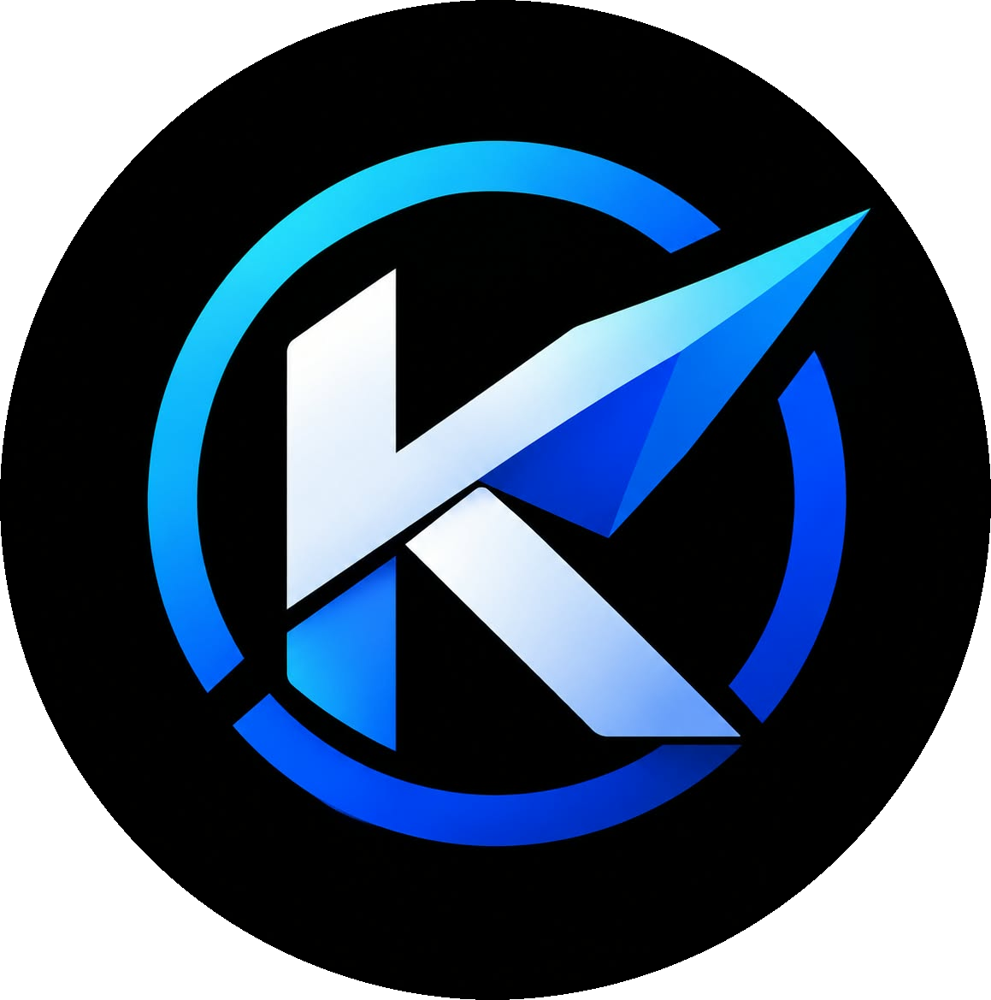

<p align="center">
  
</p>

<h1 align="center">Kinetix</h1>

<p align="center">
  Navegador web rápido y ligero, desarrollado en C++ con <b>Qt 6</b> y <b>Chromium (Qt WebEngine)</b>.
</p>

<p align="center">
  <a href="https://github.com/cvault-node/Kinetix/actions/workflows/build.yml"></a>
  <a href="https://github.com/cvault-node/Kinetix/releases/latest"></a>
</p>

---

## Descarga

Instaladores y paquetes listos para usar en la página de **[Releases](https://github.com/cvault-node/Kinetix/releases)**:

| Sistema | Archivo | Tipo |
|---------|---------|------|
| **Windows** | `Kinetix-1.0.0-win64.exe` | Instalador (NSIS) |
| **Windows** | `Kinetix-1.0.0-win64.zip` | Portable (descomprimir y ejecutar) |
| **Linux** | `Kinetix-x86_64.AppImage` | Portable (AppImage) |

> En Linux: `chmod +x Kinetix-x86_64.AppImage && ./Kinetix-x86_64.AppImage`

---

## Características

- Navegación por **pestañas** (barra horizontal o **barra lateral**).
- Animaciones de carga en pestañas e iconos de sitio.
- **Descargas** con barra de progreso animada, velocidad, tamaño y tiempo restante.
- **Marcadores** e **historial** persistentes.
- **Modo oscuro** y **claro**.
- **Zoom** con indicador visual.
- Exportación de páginas a **PDF**.
- **Editor de código** integrado en una pestaña.
- Página de **inicio** con accesos rápidos (se pueden renombrar y eliminar).
- Motores de búsqueda: **Google**, **Bing** y **DuckDuckGo**.
- Gestión de **certificados, permisos y contenido seguro** (propio de WebEngine).
- Ventanas emergentes y descargas sin bloqueos.
- Ajuste avanzado de **RAM, GPU y caché** desde Configuración.
- Sesión y cookies persistidas en disco.
- **Administrador de tareas** con el consumo de RAM y CPU de cada pestaña.
- **Ventana privada** con perfil *off-the-record* (no deja rastro en disco).
---

## Atajos de teclado

| Atajo | Acción |
|-------|--------|
| `Ctrl + T` | Nueva pestaña |
| `Ctrl + Shift + N` | Nueva ventana privada |
| `Mayús + Esc` | Administrador de tareas |
| `Ctrl + W` | Cerrar pestaña |
| `Ctrl + R` | Recargar |
| `Alt + ←` / `Alt + →` | Atrás / Adelante |
| `Ctrl + L` | Ir a la barra de direcciones |
| `Ctrl + D` | Añadir a marcadores |
| `Ctrl + B` | Mostrar/ocultar barra de marcadores |
| `Ctrl + P` | Guardar como PDF |
| `Ctrl + Shift + E` | Editor de código |
| `Ctrl + Shift + D` | Alternar modo oscuro |
| `Ctrl + Shift + H` | Borrar historial |
| `Ctrl + +` / `Ctrl + -` | Acercar / Alejar |
| `Ctrl + 0` | Restablecer zoom |
| `F11` / `Esc` | Pantalla completa / salir |
| `F1` | Acerca de Kinetix |

> **Truco:** en Configuración, escribe el comando `render` (o `recursos`) en el campo *Comando* para mostrar las opciones avanzadas de renderizado.

---

## Compilar desde el código fuente

### Requisitos

- **CMake** ≥ 3.16
- **Compilador C++17** (MSVC 2022 en Windows; GCC/Clang en Linux)
- **Qt 6.7 o superior** con los módulos **Widgets** y **WebEngineWidgets**
  (en Linux, además `Qt WebChannel`, `Qt Positioning` y `Qt SerialPort`)
  - Recomendado **Qt 6.11 o superior**: cuanto más nuevo el Qt, más nuevo el motor Chromium y más rápido es el navegador en webs pesadas. Kinetix se compila y distribuye con **Qt 6.11.2 (Chromium 140)**.

> **Nota sobre los códecs de vídeo:** las compilaciones oficiales de Qt WebEngine
> van con Chromium compilado **sin los códecs propietarios**, así que **H.264
> (MP4) y AAC no están disponibles**. Los vídeos que sirven X/Twitter, Instagram o
> la mayoría de webs en MP4/HLS **no se reproducen**; los de WebM (VP8, VP9) y
> AV1 sí. No hay ningún flag que lo arregle: hay que recompilar Qt WebEngine con
> FFmpeg de marca "Chrome" (`proprietary_codecs = true`).

### Windows (MSVC)

```powershell
cmake -S . -B build -G "Visual Studio 17 2022" -A x64
cmake --build build --config Release
```

### Linux

```bash
cmake -S . -B build -DCMAKE_BUILD_TYPE=Release
cmake --build build -j"$(nproc)"
```

El ejecutable queda en `build/Release/Kinetix.exe` (Windows) o `build/Kinetix` (Linux).

---

## Empaquetado

### Windows (instalador NSIS + portable ZIP)

Requiere [NSIS](https://nsis.sourceforge.io/) instalado.

```powershell
cd build
cpack -C Release -G NSIS   # Kinetix-1.0.0-win64.exe
cpack -C Release -G ZIP    # Kinetix-1.0.0-win64.zip
```

Las dependencias de Qt se despliegan automáticamente con `windeployqt`.

### Linux (AppImage)

El flujo de CI genera el AppImage con [linuxdeploy](https://github.com/linuxdeploy/linuxdeploy) y el plugin de Qt. También puedes crear un paquete `.deb`:

```bash
cd build
cpack -G DEB
```

---

## Integración continua

El workflow [`.github/workflows/build.yml`](.github/workflows/build.yml) compila en **Windows** y **Linux** en cada push. Al subir un tag que empiece por `v` (por ejemplo `v1.0.1`) se crea automáticamente un **Release** con el instalador, el ZIP portable y el AppImage.

```bash
git tag v1.0.1
git push origin v1.0.1
```

---

## Estructura del proyecto

```
.
├── main.cpp            # Punto de entrada y configuración de WebEngine
├── MainWindow.*        # Ventana principal (pestañas, barra, menús, descargas)
├── BrowserTab.*        # Pestaña del navegador
├── CodeEditor.*        # Editor de código integrado
├── Theme.*             # Paleta de colores centralizada y hoja de estilo
├── Utils.*             # Utilidades e iconos
├── resources/          # Iconos y recursos (.qrc, .rc)
├── packaging/          # Archivos de escritorio para Linux
└── .github/workflows/  # CI/CD (build y releases)
```

---

## Datos del usuario

La configuración, el perfil y la caché se guardan en la carpeta del usuario:

- **Windows / Linux:** `~/.navegador_personal/`

---

## Tecnologías

- **C++17**
- **Qt 6** (Widgets) + **Qt WebEngine** (Chromium)
- **CMake** + **CPack**
- **GitHub Actions**

---

## Licencia

Sin licencia definida por el momento. Si planeas distribuir o reutilizar el proyecto, añade un archivo `LICENSE` con la licencia que prefieras.
